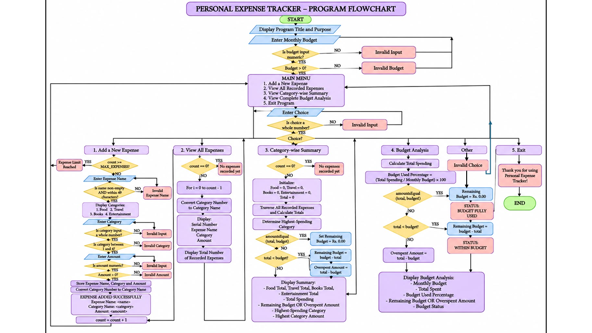

# Personal Expense Tracker

## C Programming Mini Hackathon

### Problem Statement

Develop a Personal Expense Tracker to help a student manage a monthly budget. The program accepts a monthly budget, records multiple expenses, categorizes them as Food, Travel, Books, or Entertainment, calculates total spending and remaining budget, identifies the category with the highest expenditure, and warns the user when the monthly budget is exceeded.

---

## Team Details

**Team Name:** Nexus  
**Team Number:** 02
**Batch:** 27

### Team Members

1. Chanchal
2. Bhavishya Madan
3. Diya Sharma

---

## Objectives

- Record multiple personal expenses.
- Categorize expenses into Food, Travel, Books, and Entertainment.
- Calculate total monthly expenditure.
- Calculate the remaining monthly budget or overspent amount.
- Identify the highest-spending category.
- Calculate the percentage of the monthly budget used.
- Warn the user when the monthly budget is exceeded.
- Handle invalid user inputs appropriately.

---

## Features

1. Add a New Expense
2. View All Recorded Expenses
3. View Category-wise Summary
4. View Complete Budget Analysis
5. Input Validation
6. Highest-Spending Category Detection
7. Budget Exceeded Warning
8. Menu-Driven User Interface

---

## C Programming Concepts Used

- Variables and data types
- Operators
- Conditional statements (`if`, `else if`, `else`)
- `switch` statements
- `for`, `while`, and `do-while` loops
- Arrays
- Strings
- Functions
- Structures
- Array of structures
- Preprocessor directives
- Standard C library functions

---

## Expense Categories

| Category Number | Category |
|---|---|
| 1 | Food |
| 2 | Travel |
| 3 | Books |
| 4 | Entertainment |

---

## Algorithm

1. Start the program.
2. Define an `Expense` structure containing the expense name, category, and amount.
3. Create an array of `Expense` structures to store multiple expense records.
4. Initialize the expense count to zero.
5. Accept the monthly budget from the user.
6. Validate that the budget is numeric and greater than zero.
7. Display the Main Menu.
8. Accept and validate the user's menu choice.
9. If **Add a New Expense** is selected:
   - Check whether the maximum expense limit has been reached.
   - Accept and validate the expense name.
   - Display the available categories.
   - Accept and validate the category.
   - Accept and validate the expense amount.
   - Store the expense.
   - Convert the category number to its corresponding category name.
   - Display the stored expense details.
   - Increment the expense count.
10. If **View All Recorded Expenses** is selected:
    - Check whether any expenses have been recorded.
    - Display the serial number, expense name, category, and amount for every recorded expense.
    - Display the total number of recorded expenses.
11. If **Category-wise Summary** is selected:
    - Calculate Food, Travel, Books, and Entertainment totals.
    - Calculate total spending.
    - Determine the highest-spending category.
    - Display the remaining budget or overspent amount.
12. If **Budget Analysis** is selected:
    - Calculate total spending.
    - Calculate the percentage of the budget used.
    - Display `BUDGET FULLY USED` when spending equals the budget.
    - Display `WITHIN BUDGET` when spending is below the budget.
    - Display the overspent amount and a warning when spending exceeds the budget.
13. If an invalid menu choice is entered, display an error message and return to the Main Menu.
14. Repeat the Main Menu until the user selects **Exit Program**.
15. End the program.

---

## Pseudocode

```text
BEGIN

DEFINE STRUCTURE Expense
    name
    category
    amount
END STRUCTURE

CREATE array of Expense
SET count = 0

REPEAT
    READ monthly budget

    IF budget input is not numeric THEN
        DISPLAY invalid input
    ELSE IF budget <= 0 THEN
        DISPLAY invalid budget
    END IF

UNTIL budget is numeric AND budget > 0

REPEAT

    DISPLAY Main Menu
    READ and validate choice

    IF choice = 1 THEN

        IF maximum expense limit reached THEN
            DISPLAY expense limit reached
        ELSE
            READ and validate expense name
            DISPLAY categories
            READ and validate category
            READ and validate amount

            STORE expense
            CONVERT category number to category name
            DISPLAY expense details
            SET count = count + 1
        END IF

    ELSE IF choice = 2 THEN

        IF count = 0 THEN
            DISPLAY no expenses recorded
        ELSE
            FOR every recorded expense
                CONVERT category number to category name
                DISPLAY serial number, name, category and amount
            END FOR

            DISPLAY total number of recorded expenses
        END IF

    ELSE IF choice = 3 THEN

        IF count = 0 THEN
            DISPLAY no expenses recorded
        ELSE
            INITIALIZE all category totals and total spending to 0

            FOR every recorded expense
                ADD amount to total spending
                ADD amount to corresponding category total
            END FOR

            DETERMINE highest-spending category

            IF total spending equals budget according to
               the monetary equality check THEN
                DISPLAY remaining budget = 0

            ELSE IF total spending < budget THEN
                CALCULATE and DISPLAY remaining budget

            ELSE
                CALCULATE and DISPLAY overspent amount
            END IF

            DISPLAY category-wise summary
        END IF

    ELSE IF choice = 4 THEN

        CALCULATE total spending

        CALCULATE Budget Used Percentage =
        (Total Spending / Monthly Budget) * 100

        IF total spending equals budget according to
           the monetary equality check THEN

            DISPLAY remaining budget = 0
            DISPLAY BUDGET FULLY USED

        ELSE IF total spending < budget THEN

            CALCULATE remaining budget
            DISPLAY WITHIN BUDGET

        ELSE

            CALCULATE overspent amount
            DISPLAY WARNING: MONTHLY BUDGET EXCEEDED

        END IF

    ELSE IF choice = 5 THEN

        DISPLAY exit message

    ELSE

        DISPLAY invalid choice

    END IF

UNTIL choice = 5

END
```

---

## Flowchart

The following flowchart represents the complete program logic, including input validation, expense recording, category-wise analysis, budget analysis, invalid choices, and menu repetition.



---

## How to Compile and Run

### Using GCC

Open the terminal in the project folder and compile the program using:

```bash
gcc expense_tracker.c -o expense_tracker
```

On Windows, execute the program using:

```powershell
.\expense_tracker
```

---

## Sample Test Cases

### Test Case 1: Normal Spending

**Monthly Budget:** Rs. 10000

**Expenses:**

- Lunch - Food - Rs. 500
- Metro Ticket - Travel - Rs. 300
- C Programming Book - Books - Rs. 800
- Movie Ticket - Entertainment - Rs. 400

**Expected Output:**

- Food Total: Rs. 500.00
- Travel Total: Rs. 300.00
- Books Total: Rs. 800.00
- Entertainment Total: Rs. 400.00
- Total Spending: Rs. 2000.00
- Remaining Budget: Rs. 8000.00
- Highest-Spending Category: Books
- Highest Category Amount: Rs. 800.00
- Budget Used: 20.00%
- Status: WITHIN BUDGET

**Actual Output:** 

- Food Total: Rs. 500.00
- Travel Total: Rs. 300.00
- Books Total: Rs. 800.00
- Entertainment Total: Rs. 400.00
- Total Spending: Rs. 2000.00
- Remaining Budget: Rs. 8000.00
- Highest-Spending Category: Books
- Highest Category Amount: Rs. 800.00
- Budget Used: 20.00%
- Status: WITHIN BUDGET

**Result:** PASS

---

### Test Case 2: Budget Fully Used

**Monthly Budget:** Rs. 10000  
**Total Spending:** Rs. 10000

**Expected Output:**

- Remaining Budget: Rs. 0.00
- Budget Used: 100.00%
- Status: BUDGET FULLY USED

**Actual Output:**

- Remaining Budget: Rs. 0.00
- Budget Used: 100.00%
- Status: BUDGET FULLY USED

**Result:** PASS

---

### Test Case 3: Budget Exceeded

**Monthly Budget:** Rs. 10000  
**Total Spending:** Rs. 12000

**Expected Output:**

- Overspent By: Rs. 2000.00
- Budget Used: 120.00%
- Status: WARNING: MONTHLY BUDGET EXCEEDED!

**Actual Output:**

- Overspent By: Rs. 2000.00
- Budget Used: 120.00%
- Status: WARNING: MONTHLY BUDGET EXCEEDED!

**Result:** PASS
---

### Test Case 4: Invalid Inputs

Test the program using:

- Non-numeric budget
- Zero or negative budget
- Non-numeric menu choice
- Menu choice outside 1-5
- Empty expense name
- Invalid category
- Non-numeric expense amount
- Zero or negative expense amount

**Expected Output:** The program rejects invalid input and asks the user to enter a valid value again.

**Actual Output:** All tested invalid inputs were rejected and the program requested valid input again.

**Result:** PASS

---

## Project Files

- `expense_tracker.c` - Complete C source code
- `README.md` - Project documentation
- `flowchart.png` - Program flowchart
- `screenshots/` - Sample program outputs

---

## Conclusion

The Personal Expense Tracker is a menu-driven C program that helps students record and analyze monthly expenses. It provides category-wise expenditure totals, calculates the remaining or overspent budget, identifies the highest-spending category, validates user input, and warns the user when the monthly budget is exceeded.